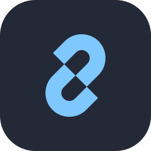
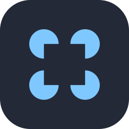
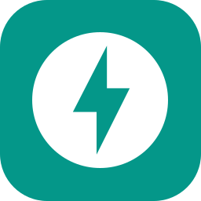
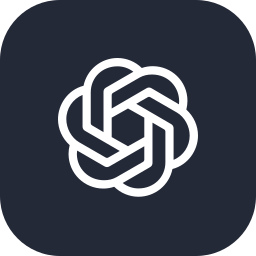
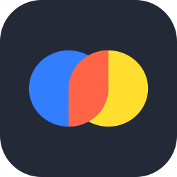
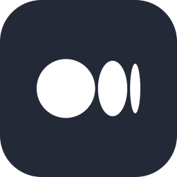

## 🙋‍♀️ Hakkımda

Python, LangChain ve LangGraph ile LLM tabanlı uygulamalar geliştiriyorum. Doğru bilgiyi bulup getiren RAG sistemlerinden, adım adım düşünüp karar veren ajanlara kadar yapay zekânın gerçek bir işe yaradığı çözümler üretmeyi seviyorum.

Üreterek öğreniyorum. Projelerimi küçük, okunabilir ve iyi belgelenmiş tutmaya özen gösteriyorum.

## 🎯 Şu an odaklandıklarım

- 🔍 **RAG:** belgelerden doğru bilgiyi bulup kaynağıyla sunan sistemler
- 🤖 **AI Ajanları:** araç kullanan, plan yapan ve kendi çıktısını doğrulayan ajanlar
- 🔗 **LangChain & LangGraph:** çok adımlı, durum tutan LLM iş akışları

## 🛠️ Teknolojiler

&nbsp;&nbsp;
&nbsp;&nbsp;
&nbsp;&nbsp;
&nbsp;&nbsp;
&nbsp;&nbsp;

## 🤝 Bağlantıda kalalım

&nbsp;&nbsp;
&nbsp;&nbsp;

